# Deck

> 🚧 **Work in progress.** Deck is not a finished product: I use it every day and keep building it. Expect rough
> edges, and expect this page to change.

**YouTube Music has no way to let a room full of people pick the music, and its player is the same for everyone.
Deck is an Android app that sits on top of YouTube Music and turns it into a personal "deck": a home screen built
from what you listen to, its own player with synced lyrics, a queue it controls itself, a mixing desk with a real
equalizer, and a party mode where guests scan a QR code and add songs from their browser.**

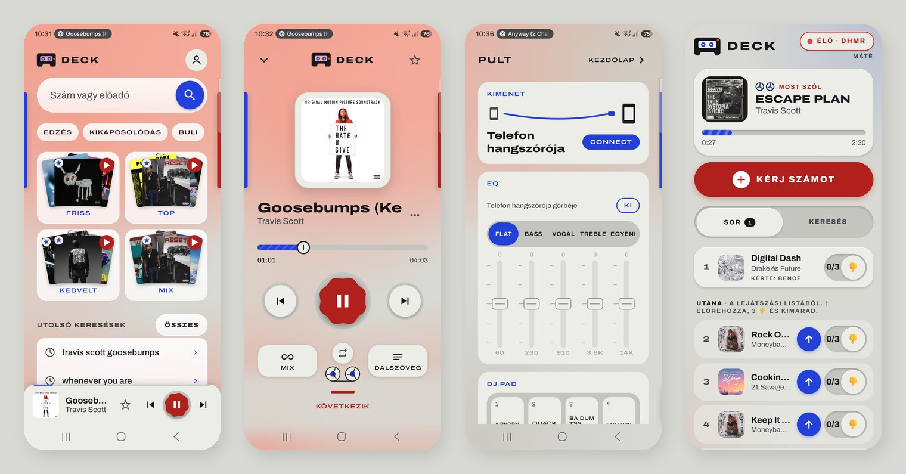

YouTube Music stays the playback engine. Deck reads and controls it only through official Android APIs
(media sessions); it never modifies or patches the YouTube Music app.

> Magyar összefoglaló: [lent](#magyarul). The source code is private; I'm happy to show it on request.

## Contents

- [The problem](#the-problem)
- [Features](#features)
- [Architecture](#architecture)
- [Engineering decisions](#engineering-decisions)
- [Testing](#testing)
- [Requirements and install](#requirements-and-install)
- [Links](#links)
- [Magyarul](#magyarul)

## The problem

At a house party the music runs from one phone. Everyone wants to add a song, so the phone travels around the
room, or the host types requests all night, and there is no way to say "not this one". On top of that YouTube
Music's player cannot be changed: no synced lyrics on the main screen, no "play this next" that respects what you
picked, no way to see and control the queue the way you want, no equalizer that follows your headphones.

Deck is the layer I wanted on top: **a custom remote, mixing desk and party host for YouTube Music, built only on
public Android APIs.**

## Features

| Home screen | Player | Synced lyrics |
|---|---|---|
| 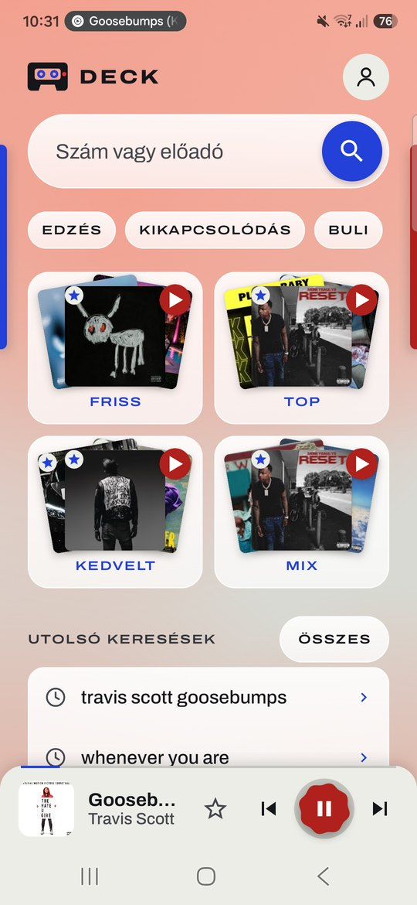 |  | 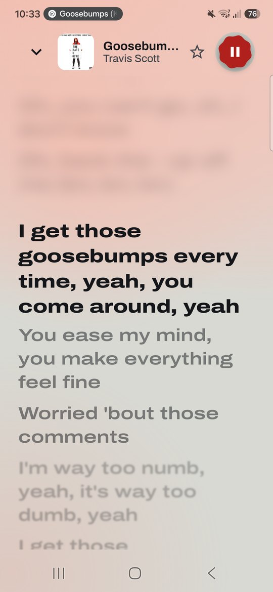 |

- **Home screen ("lobby").** Search, mood keys (workout, chill, party and more) and four cover-fan cards:
  FRISS (recent), TOP, KEDVELT (liked) and MIX. They are built from the listening history on the phone and the
  liked songs, at zero API quota. The red key on a card plays it right away, the card itself opens the full list.
- **Mini ↔ full player.** A mini-player stays at the bottom of the home screen. Drag it up and the cover grows
  out of it into the full player; drag anywhere on the full player to put it back. The drag follows the finger.
- **Player.** Cover, seek bar, transport keys, a repeat key and a star for YouTube Music's liked songs. The
  background is a mesh of colors taken from the cover, tuned so every text stays readable (contrast checked by
  unit tests). A title that does not fit scrolls slowly. Double tap on the cover seeks ±10 s.
- **Synced lyrics** from [LRCLIB](https://lrclib.net): the current line is big and sharp, the far lines fade
  and blur; tap a line to jump there.
- **Starts in the background.** If YouTube Music is not running, Deck wakes it up without bringing it to the
  front, and the song plays about 1–1.6 s later ([how](docs/spike-background-start.md)).
- **The song, not the music video.** Whatever you start (a search hit, a card, MIX, a party request), Deck
  plays the song version ("Artist - Topic") and falls back to the video only when there is no song.
- **Search.** Personal results appear while you type; YouTube results follow after a short pause.
- **Liked songs and playlists.** The star is YouTube Music's own "like". From the ⋯ key next to the title you
  can add the song to one of your playlists or to a new private one, with undo. Write access is asked for only
  the first time you need it.
- **MIX.** One key starts an endless mix from the song that plays now, from the same second.
- **Own queue ("Következőnek").** "Play next" on any song. Deck starts it about 1.5 s before the current song
  ends, and a skip (from Deck, the notification or a headset) goes to Deck's queue first.
- **Unavailable songs.** A song blocked in your country or removed is greyed out, and a "VÁLTOZAT" key offers up
  to six versions of the same song that do play.

The cards change on every pull-down, and the player grows out of the mini-player:

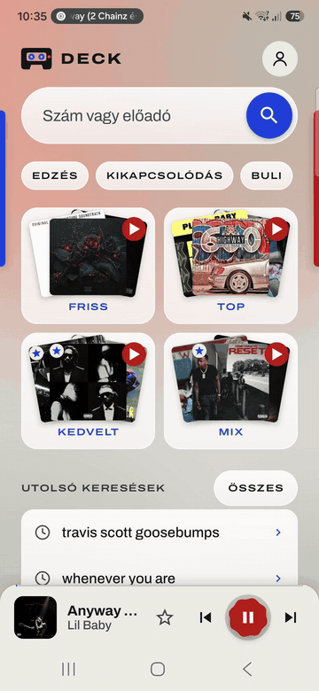 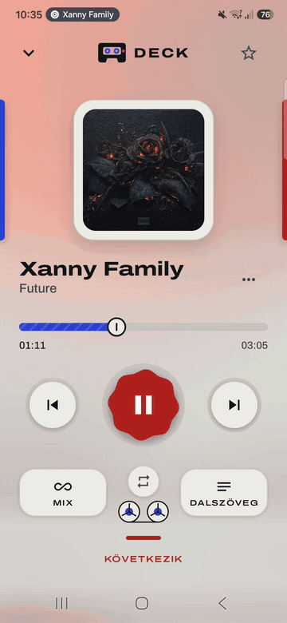

**Track change.** The old cover slides out in the direction of the skip and blurs, the new one comes in sharp:

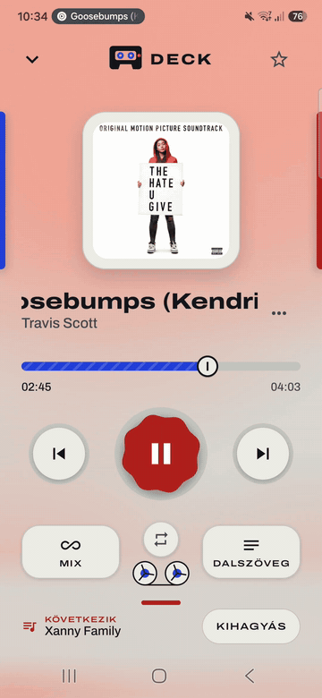

| Search | "Következik" (Up next) |
|---|---|
|  |  |

**"Következik" (Up next).** A full-screen view with Deck's own queue on top and YouTube Music's whole queue
below. Songs moved forward or swiped out stay in place, greyed and marked ("ELŐREHOZVA" / "KIHAGYVA"), with undo.

### PULT, the mixing desk

| Output and EQ | DJ pad, tape shelf, sleep timer |
|---|---|
| 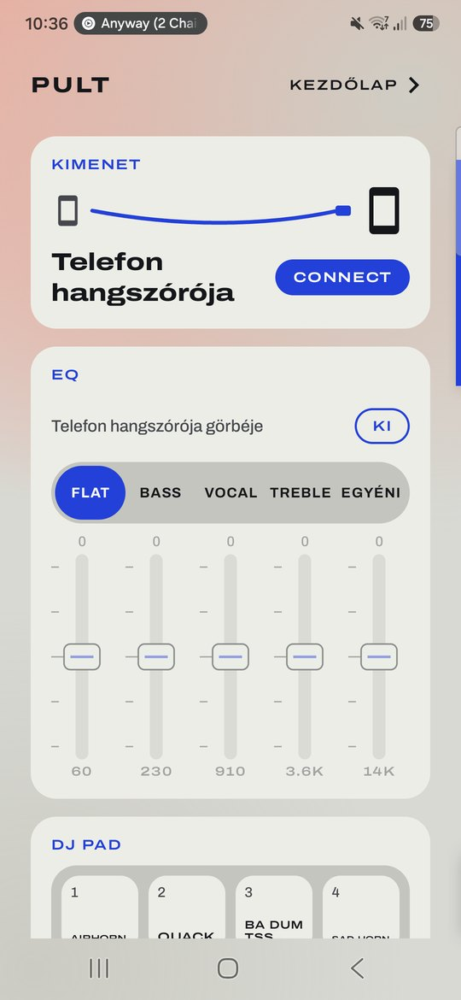 | 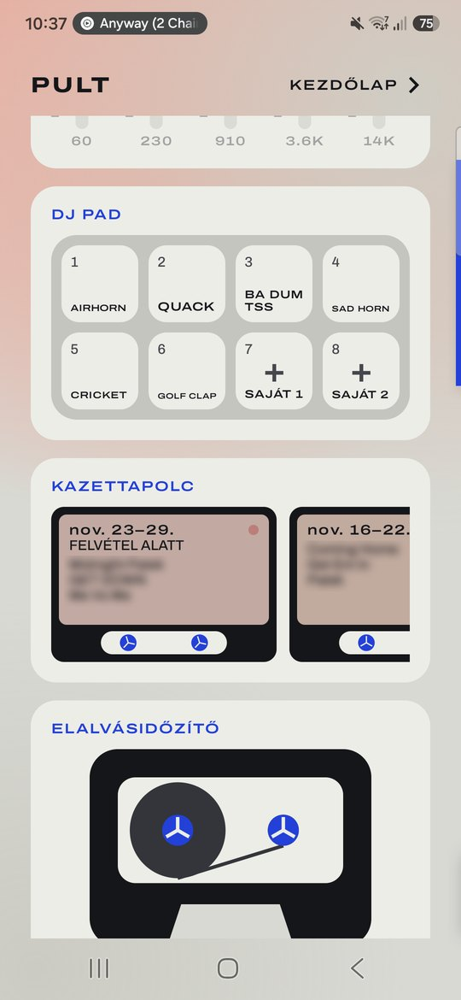 |

The blue tab on the left edge opens the PULT, the mirror image of the party view on the right.

- **Output.** The active output (speaker, headphones, car) as a patch cable, the other connected devices as jacks,
  and the system's output switcher one tap away. For each Bluetooth device you can choose to resume playback when
  it connects.
- **EQ.** A real 5-band equalizer on the phone's output, with a separate curve for every device. FLAT means no
  effect at all: the device sounds exactly as it does without Deck.
- **DJ pad.** Six CC0 sounds (airhorn, rimshot, …) and two pads you record yourself. YouTube Music ducks under the
  pad instead of stopping.
- **Tape shelf.** Every week becomes a cassette with that week's top 10, built from the history on the phone.
- **Sleep timer.** 15, 30 or 60 minutes, or until the end of the song; the music fades out and stops.

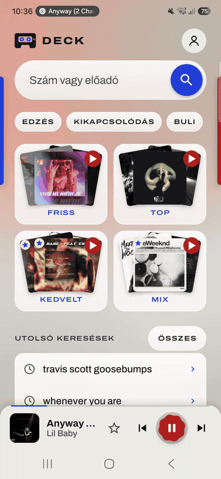

### Party mode ("Buli")

| Host view | QR code | Up next during a party |
|---|---|---|
| 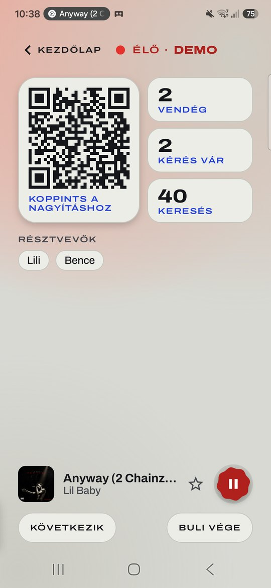 | 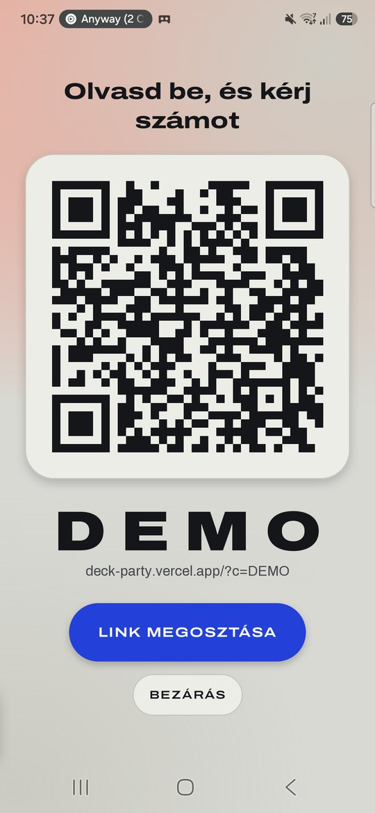 | 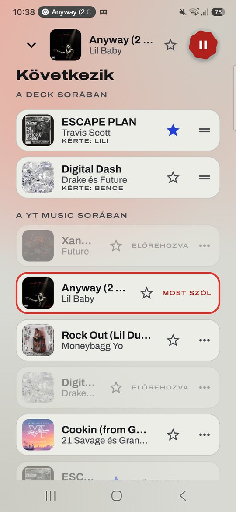 |

- The host starts a party from the song that plays and shows a QR code. Guests open a web page with **no app and
  no account**, pick a nickname and request songs by search, or move a song of the playing list forward with ↑.
- **A party uses the normal player.** Every request goes into Deck's own queue in the order it arrived, marked
  "KÉRTE: …" (requested by), and plays like any "Play next" song, also with the screen off. Guests see exactly
  Deck's "Up next" order.
- **Only 👎.** Three dislikes take any song out, a request or a song of the list. There are no likes and no
  ranking: the order is first come, first played.
- The host view shows the guests, the waiting requests and the searches left for the day. "Buli vége" ends the
  party and deletes everything of it from the server.

The party view lives to the right of the player, like winding a cassette:

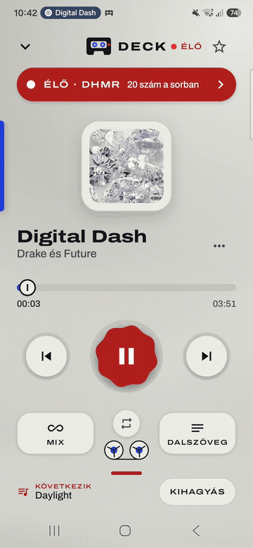

The guest page on a phone, and joining, moving a song forward, the third 👎 taking a song out:

 

On a laptop the guest page shows two columns:

The app's interface is in Hungarian.

## Architecture

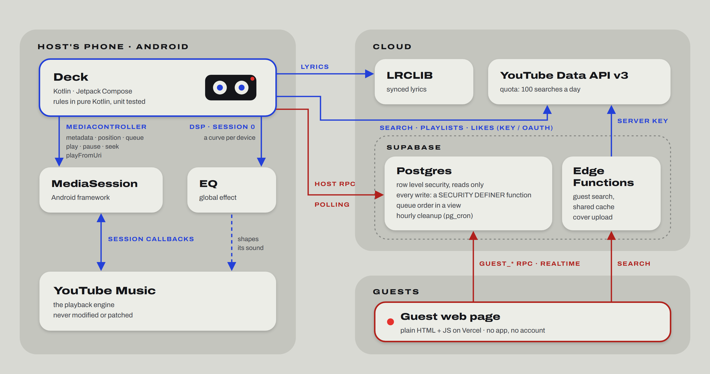

- **Android app**: single activity, Jetpack Compose, ViewModel + `StateFlow`, coroutines, no DI framework.
  Networking is `HttpURLConnection` + `org.json`: no HTTP, image or Supabase client library. Every decision that
  can be separated from Android (queue stepping, navigation, waking YouTube Music, song version, EQ curve, sleep
  timer) is a pure Kotlin object with its own unit tests. Release build with R8 + resource shrinking: about 4.6 MB.
- **Backend**: Supabase Postgres with row level security, Postgres functions for every write, two Edge Functions
  (guest search with a shared cache, cover upload), an hourly cleanup job (pg_cron).
- **Guest page**: one HTML file and one JS file, no framework, no build step, hosted on Vercel.

## Engineering decisions

Longer write-ups: [the playback spike](docs/spike-playback.md),
[starting YouTube Music in the background](docs/spike-background-start.md), [party design](docs/party-design.md),
[design directions](docs/design-directions.md) (each also in Hungarian, `-hu.md`). Two code excerpts:
[snippets/](snippets/).

### 1. The spike: how do you start a specific song in someone else's app?

YouTube Music has no public "play this" API, and its media session advertises abilities it does not have. Before
building anything I tested every route on the phone with a throwaway debug panel: `playFromSearch`,
`playFromMediaId`, search intents, view intents, several URL forms. Two of the three advertised play actions did
nothing; an unadvertised one (`skipToQueueItem`) worked. The winner was
`transportControls.playFromUri("https://music.youtube.com/watch?v=<id>")`: it starts exactly that song **in
the background**, without bringing YouTube Music to the front. Adding to YouTube Music's queue turned out to be
impossible, which decided the whole architecture: **Deck has to own the queue and start every song itself.**

### 2. The stepping engine: timing, autoplay, ads, own queue

The rules ("what should happen now?") live in one pure Kotlin object with no Android, no network and no clock:
it takes a snapshot of the player plus the head of the queue and returns actions. That makes every rule
unit-testable ([excerpt](snippets/QueueEngine-core.kt)). The next song is started 1.5 s before the end (the
cut is hard; a crossfade is not possible from outside). The hard part is recognition: YouTube Music exposes no
video id and fills its metadata in steps (title, then artist, then the title again with "feat."), so songs are
matched by a cleaned title, and **an uncertain match never starts a new song**; the first live test skipped
through the whole queue before that rule existed. A skip is told apart from a song the user picked on purpose
(queue row id + 1), and only the skip gives way to Deck's queue. Ads are recognized by four independent signals
and simply waited out, with a 3-minute cap so a wrong guess cannot stall the music.

### 3. Party security: no accounts, but nothing writable from outside

Guests have no login, so the database does the policing. Tables allow only `SELECT` from the API (column-level
grants hide the party code and hashes); **every write goes through a `SECURITY DEFINER` function** with an empty
`search_path` that checks who may do what and locks the party row, so limits cannot race. The host is proven by a
random `host_secret` returned once at creation; guests get a random token; only SHA-256 hashes are stored. The
key that opens a party ships inside the public APK, so it is treated as public: **project-wide caps** (2 parties
at a time, 10 a day, 50 guest searches a day) protect the YouTube quota, next to per-guest and per-party limits
and a 24-hour shared search cache. Each QR code carries a per-party link token, so an old QR code can never lead
into a later party that happens to get the same 4-letter code. Everything of a party is deleted when it ends,
or after 12 hours at the latest.

### 4. The voting bug

The queue order used to be a formula: `arrival_index − net_votes × 1.5`. On paper one like moves a song one
place. In a real party songs get played, deleted and withdrawn, which leaves holes in the arrival numbers, and
then a like sometimes did nothing: with A1 B2 C3 D4, a like on C gives A C B D; a like on D gives it key 2.5,
but B has 2, so D stays put although it sits right under B. Re-numbering densely does not help either. The fix
replaced the formula with a **stored order**: each vote swaps the song with its free neighbour exactly as many
times as the guest's vote changed ([SQL excerpt](snippets/vote-moves-one-place.sql)). In 1.2 the party dropped
likes and ranking altogether (decision 9), but the lesson stayed: an order that people watch must be stored and
moved one step at a time, never recomputed from a formula.

### 5. "Következik": a full-screen view instead of a bottom sheet

The up-next list started as a Material bottom sheet. With a long, scrollable list inside, the sheet's drag and
the list's scroll kept fighting on fast gestures: half-open sheets stuck, the list slid under a closing sheet,
positions jumped back afterwards. I fixed one case after another with nested-scroll hooks, and each fix made the
next edge case. We then compared four options (only full opening, separate drag zones, a full view, a custom
sheet) and chose the full view: **one gesture per surface**, the list only scrolls, a down arrow or Back closes
it. Every feature stayed, the gesture code was deleted, and the view now rises from the bottom like the other
full-screen views.

### 6. Design: from three directions to "Kazetta"

The first design was generic (dull fonts, rectangles everywhere). I researched players and hardware
(Material 3 Expressive, Nothing OS, Teenage Engineering, Apple Music / Spotify, open-source YT Music clients)
and built **three complete directions into the app**, switchable on the phone: A "Kazetta" (a light, matte
pocket device: round keys, a fader, spinning tape reels), B "Lemez" (dark, record-player, shape morphing) and
C "Pakli" (a card table for parties). A won. Design 2.0 later added a second accent, a REC red for everything
that is live (play key, party, "now playing"), a cover-colored mesh background with contrast guaranteed by
tests, and motion that stops on pause and follows the system's "remove animations" setting.

| A – Kazetta | B – Lemez | C – Pakli | Kazetta today |
|---|---|---|---|
| 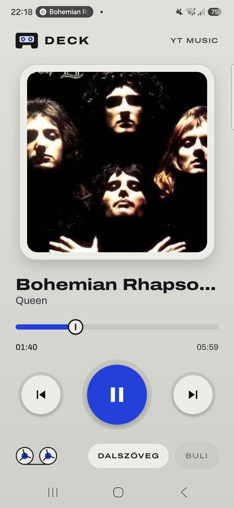 | 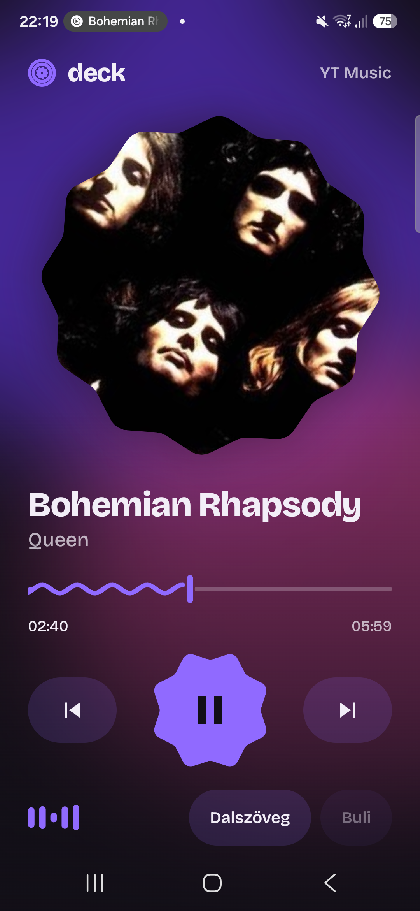 | 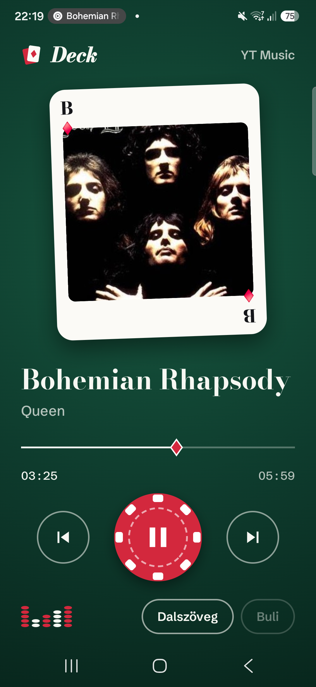 |  |

### 7. Waking YouTube Music without opening it

When YouTube Music was not running, Deck used to open it with a view intent: the right song played, but YouTube
Music jumped to the front every time, also when Deck's own queue needed the next song with the screen locked.
I measured every "closed" state on the phone (paused, killed by the system, force-stopped, screen locked). The
key turned out to be a side effect: YouTube Music **refuses** Deck's connection to its media browser service, but
binding to it starts the process, which creates an inactive session. A media PLAY key about 500 ms later
wakes that session up, Deck pauses it at once and starts the requested song with `playFromUri`, so the old song
is never heard (450 ms was too early: 0 of 3 tries; 500 ms: 3 of 3). The key goes out only when the system
names YouTube Music as the receiver of media keys, so it can never start another app. The song now plays
1.1–1.6 s after the tap, nothing comes to the front, and the pure Kotlin timing plan has its own tests
([write-up](docs/spike-background-start.md)).

### 8. The song, not the music video

YouTube Music plays whatever id it gets: a video id plays the music video, and a mix seeded with it is built from
videos. In the history on my phone 107 of 165 ids were videos, so MIX and many starts quietly played clips. Deck
now resolves the **song version** ("Artist - Topic") before every start, from the cheapest source up: a local
store (free), then one batched `videos.list` call for all local candidates (1 unit for 50 ids), and only then
one search for `"<artist> <title> \"Provided to YouTube\""`, a phrase every auto-generated song description
starts with, so the song comes first. A search costs 100 units and the project has just 100 searches a day, so
all 50 results go into the store, and a "no song version" answer is remembered for 30 days. The first build
warmed the store one song at a time and spent about 440 units on a 777-song list; batching fixed that.

### 9. Party mode: from a separate queue to one player

1.1 gave the party its own queue with likes, dislikes and a ranked order. For 1.2 I first tried a version where
YouTube Music's own mix continued after the requests ("D"), with its rows mirrored to the guests. The live test
was a mess: YouTube Music exposes ids only for video rows, a mix reopened after a request comes back different,
and two engines (the party's and the queue's) fought over the next song. The decision was to **delete the
party's stepping entirely**: a request becomes a normal "Play next" song in Deck's own queue, the guests see
Deck's "Up next" order, and the only vote is 👎 (three take a song out). Playback logic, which already worked,
was not touched; the party only adds. A whole layer of code (mix sync, return-to-playlist, the host's draggable
party queue) was removed, and the server got a simpler order: the list the Deck sends.

### 10. Smooth drags, measured

After the home screen and the mini-player arrived, fast drags between mini and full player stuttered. I measured
with `dumpsys gfxinfo` on 12 fast (120 ms) drags: every slow frame was on the UI thread, so the cause was
recomposition, not drawing. The base (home screen + player layer) moved outside the screen transition and is now
always composed, the full player waits fully built below the screen, and during a drag the position is read only
while drawing or laying out, never in composition. A full-screen blur behind the player was replaced by a fade
and a slight scale. Janky frames went from 33 to 21 on the same test, and the settle spring got softer so the
remaining work has time to finish.

### 11. A real equalizer from outside the player

YouTube Music announces no audio session, so an equalizer cannot attach to its player. A spike tried three
routes: a `DynamicsProcessing` effect on the global output mix (session 0), waiting for YouTube Music's
"open effect session" broadcast, and the system's own EQ panel. Only the first works, and it works well: the
effect runs on the same mixer thread as YouTube Music, follows a switch from speaker to Bluetooth headphones,
and stacks with the phone maker's EQ. Deck therefore only adds: FLAT releases the effect, and each device keeps
its own curve. The DJ pad uses the same "only add" idea for sound: a transient audio focus that allows ducking
makes the system lower YouTube Music to about 20% while a pad plays, without pausing it.

## Testing

| What | How many | What it covers |
|---|---|---|
| Unit tests (JVM) | **435** in 59 classes | stepping engine (party 44, own queue 27), history and home cards 18, navigation rules 17, link and party parsing, lyrics parser, song version choice, waking YouTube Music, EQ curves and fades, sleep timer, playlist jumps, liked-song matching, cover colors and contrast, seeking gestures, skip marks |
| Sequence test | **60 seeds × 120 random steps** | random skips, taps, additions and removals against a simulated YouTube Music queue; invariants checked after every step (a skipped song never keeps playing, a picked song is never overridden) |
| Server tests (Node, against the live backend) | **29** | security (nothing writable directly), nicknames, request limits and cooldown, the Deck's order, dislikes taking songs out, moving a song forward, search limits and cache, global caps, link tokens, test-party cleanup, covers |
| On the phone | each release | an R8 (shrunk) build signed with the debug key, on a Galaxy S25: home screen, mini ↔ full player, search, starting in the background, lyrics, up next, own queue, MIX, PULT (EQ, DJ pad, sleep timer), a full party with guests joining, moving songs forward and voting a song out |

The server tests open their parties with a separate test key and their own counters, so they never use up the
real daily limits.

## Requirements and install

- **Android 12 or newer** (built and tested on a Galaxy S25).
- The **YouTube Music** app and **YouTube Music Premium**: Deck starts songs while YouTube Music is in the
  background, and background playback is a Premium feature.

1. Download the APK from [Releases](../../releases) and open it on the phone; allow installs from that source once.
   Version 1.2.0 updates 1.1.0 in place.
2. Open Deck and allow **notification access**: it is the only official way for an app to see and control
   another app's playback. Deck does not read or store notifications. If the switch is greyed out:
   *Settings > Apps > Deck > ⋮ > Allow restricted settings*.
3. For party mode allow notifications and running without battery restrictions (Samsung stops background
   apps otherwise).

Limits of the published APK: search uses my YouTube API quota (100 searches a day, shared by everyone), the party
server has the caps above, and Google sign-in (playlists, liked songs) works only for test users of my Google
Cloud project.

## Links

- Guest page: [deck-party.vercel.app](https://deck-party.vercel.app) (needs a running party)
- Google Play: later
- Releases and changelog: [Releases](../../releases)
- Source code: private, I'm happy to show it on request.

## Credits

Lyrics from [LRCLIB](https://lrclib.net). Font: [Archivo](https://github.com/Omnibus-Type/Archivo) (SIL Open Font
License 1.1). DJ pad sounds from [Freesound](https://freesound.org) (CC0 1.0). Libraries: AndroidX / Jetpack
Compose, ZXing core, Reorderable (Apache License 2.0), Google Play services. Deck is an unofficial personal
project, not affiliated with Google, YouTube or YouTube Music; those names are trademarks of Google LLC. Deck does
not download, store or modify music. See [LICENSE](LICENSE).

## Magyarul

> 🚧 **A Deck még készül**, nem kész projekt: minden nap használom és fejlesztem.

A Deck egy Android app a YouTube Music fölé. Van egy kezdőlapja, amely a hallgatási előzményekből és a kedvelt
számokból válogat, és van saját lejátszója szinkronizált dalszöveggel. Mini-playerrel, kereséssel, saját sorral
("Következőnek") és MIX-szel működik. A PULT a keverőpult: kimenet, eszközönkénti valódi EQ, DJ pad, heti
kazettapolc és elalvásidőzítő. Buli módban a vendégek QR-kóddal, egy weboldalon kérnek számot. A kérés a Deck
saját sorába kerül, a lejátszási lista számait ↑ gombbal előre lehet hozni, és 3 👎 kivesz egy számot. A
lejátszást a YouTube Music végzi, a Deck csak hivatalos Android API-kon át olvassa és vezérli.

- **Újdonságok az 1.2.0-ban:** kezdőlap és mini-player, indítás a háttérben, mindig a dalváltozat szól,
  kedvelések és playlistek, PULT, buli a normál lejátszóval. Részletek a [Releases](../../releases) oldalon.
- **Kell hozzá:** Android 12+, YouTube Music és YouTube Music Premium.
- **Telepítés:** APK a [Releases](../../releases) oldalról; első induláskor értesítési hozzáférést kér.
- **Részletesen, magyarul:** [lejátszás-spike](docs/spike-playback-hu.md),
  [indítás a háttérben](docs/spike-background-start-hu.md), [buli mód terve](docs/party-design-hu.md),
  [dizájnirányok](docs/design-directions-hu.md); két kódrészlet: [snippets/](snippets/).
- **A forráskód privát, kérésre megmutatom.**
