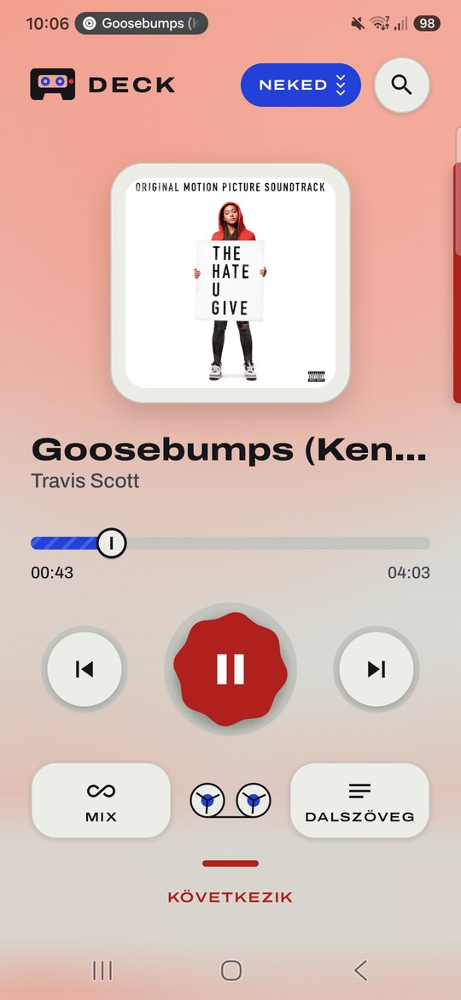
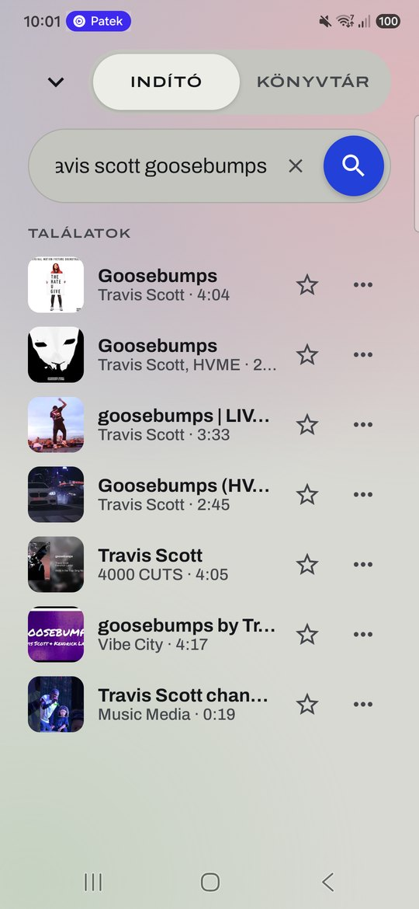
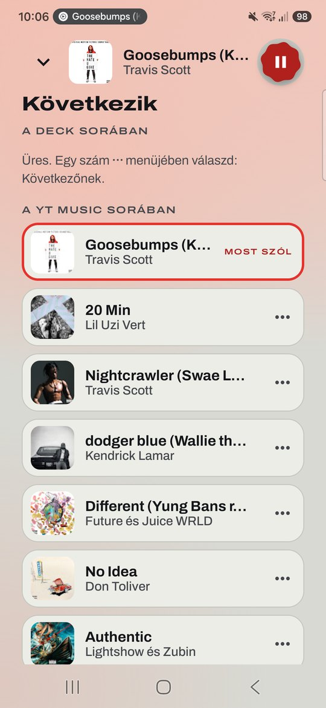
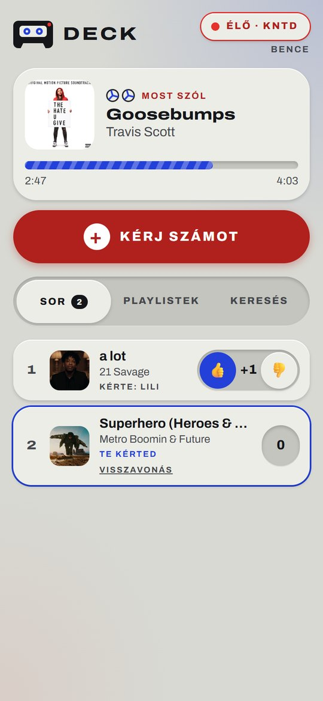
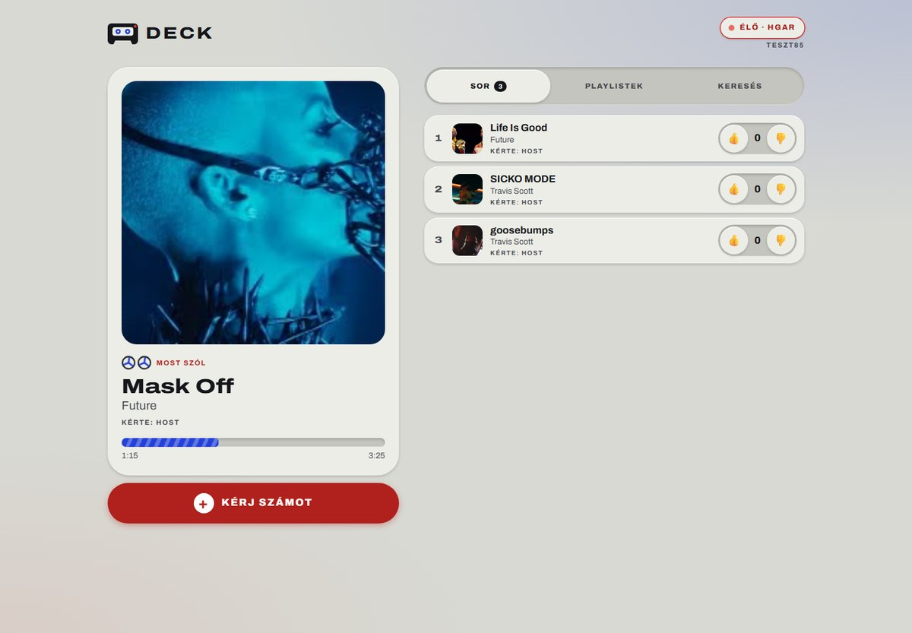
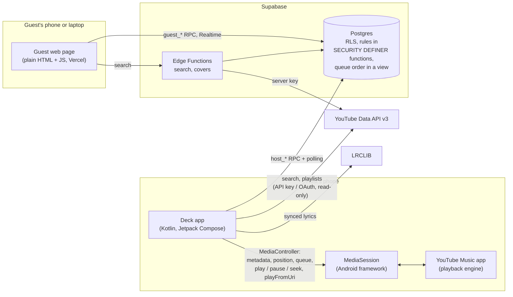

# Deck

> 🚧 **Work in progress.** Deck is not a finished product: I use it every day and keep building it. Expect rough
> edges, and expect this page to change.

**YouTube Music has no way to let a room full of people pick the music, and its player is the same for everyone.
Deck is an Android app that sits on top of YouTube Music and turns it into a personal "deck": its own player
with synced lyrics, a queue it controls itself, and a party mode where guests scan a QR code and request and
vote on songs from their browser.**

YouTube Music stays the playback engine. Deck reads and controls it only through official Android APIs
(media sessions); it never modifies or patches the YouTube Music app.

> Magyar összefoglaló: [lent](#magyarul). The source code is private; I'm happy to show it on request.

## Contents

- [The problem](#the-problem)
- [Features](#features)
- [Architecture](#architecture)
- [Engineering decisions](#engineering-decisions)
- [Testing](#testing)
- [Requirements and install](#requirements-and-install)
- [Links](#links)
- [Magyarul](#magyarul)

## The problem

At a house party the music runs from one phone. Everyone wants to add a song, so the phone travels around the
room, or the host types requests all night, and there is no voting. On top of that YouTube Music's player cannot be changed: no synced lyrics on the main screen, no
"play this next" that respects what you picked, no way to see and control the queue the way you want.

Deck is the layer I wanted on top: **a custom remote and party host for YouTube Music, built only on public
Android APIs.**

## Features

| Player | Synced lyrics | Search |
|---|---|---|
|  |  |  |

- **Player.** Cover, title, seek bar and transport keys for whatever YouTube Music plays. The background is a
  mesh of colors taken from the cover, tuned so every text stays readable (contrast checked by unit tests).
  Double tap on the cover seeks ±10 s.
- **Synced lyrics** from [LRCLIB](https://lrclib.net): the current line is big and sharp, the far lines fade
  and blur; tap a line to jump there.
- **Search ("Indító").** Search YouTube and start a song without opening YouTube Music, up to 8 favorites.
- **Library ("Könyvtár").** Google sign-in (read-only scope) for your own playlists and liked music, play or shuffle.
- **MIX.** One key starts an endless radio from the song that plays now.
- **Own queue ("Következőnek").** "Play next" on any song. Deck starts it about 1.5 s before the current song
  ends, and a skip (from Deck, the notification or a headset) goes to Deck's queue first.

**Track change.** The old cover slides out in the direction of the skip and blurs, the new one comes in sharp:

**"Következik" (Up next).** A full-screen view with Deck's own queue on top and YouTube Music's whole queue
below. Songs moved forward or swiped out stay in place, greyed and marked ("ELŐREHOZVA" / "KIHAGYVA"), with undo.

### Party mode ("Buli")

| Host view | QR code | Guest page (phone) |
|---|---|---|
|  |  |  |

- The host starts a party and shows a QR code. Guests open a web page with **no app and no account**, pick a
  nickname, request songs (from the host's playlists or by search) and vote 👍 / 👎.
- Deck runs the queue: about 1.5 s before a song ends it starts the next one in YouTube Music, also with the
  screen off. If YouTube Music's autoplay jumps in, Deck overrides it. If an ad plays (no Premium), it waits.
- The host can pin, reorder, skip and remove; votes never move a pinned song.

The party view lives to the right of the player, like winding a cassette:

The guest page, joining, searching, requesting and voting:

On a laptop the guest page shows two columns:

The app's interface is in Hungarian.

## Architecture

- **Android app**: single activity, Jetpack Compose, ViewModel + `StateFlow`, coroutines, no DI framework.
  Networking is `HttpURLConnection` + `org.json`: no HTTP, image or Supabase client library. Release build
  with R8 + resource shrinking: about 3.4 MB.
- **Backend**: Supabase Postgres with row level security, Postgres functions for every write, two Edge Functions
  (guest search with a shared cache, cover upload), an hourly cleanup job (pg_cron).
- **Guest page**: one HTML file and one JS file, no framework, no build step, hosted on Vercel.

## Engineering decisions

Longer write-ups (in Hungarian): [the spike](docs/spike-playback.md), [party design](docs/party-design.md),
[design directions](docs/design-directions.md). Two code excerpts: [snippets/](snippets/).

### 1. The spike: how do you start a specific song in someone else's app?

YouTube Music has no public "play this" API, and its media session advertises abilities it does not have. Before
building anything I tested every route on the phone with a throwaway debug panel: `playFromSearch`,
`playFromMediaId`, search intents, view intents, several URL forms. Two of the three advertised play actions did
nothing; an unadvertised one (`skipToQueueItem`) worked. The winner was
`transportControls.playFromUri("https://music.youtube.com/watch?v=<id>")`: it starts exactly that song **in
the background**, without bringing YouTube Music to the front. Adding to YouTube Music's queue turned out to be
impossible, which decided the whole architecture: **Deck has to own the queue and start every song itself.**

### 2. The stepping engine: timing, autoplay, ads, own queue

The rules ("what should happen now?") live in one pure Kotlin object with no Android, no network and no clock:
it takes a snapshot of the player plus the head of the queue and returns actions. That makes every rule
unit-testable ([excerpt](snippets/QueueEngine-core.kt)). The next song is started 1.5 s before the end (the
cut is hard; a crossfade is not possible from outside). The hard part is recognition: YouTube Music exposes no
video id and fills its metadata in steps (title, then artist, then the title again with "feat."), so songs are
matched by a cleaned title, and **an uncertain match never starts a new song**; the first live test skipped
through the whole queue before that rule existed. Autoplay is overridden in a party; in solo mode a skip is told
apart from a song the user picked on purpose (queue row id + 1), and only the skip gives way to Deck's queue.
Ads are recognized by four independent signals and simply waited out, with a 3-minute cap so a wrong guess
cannot stall a party.

### 3. Party security: no accounts, but nothing writable from outside

Guests have no login, so the database does the policing. Tables allow only `SELECT` from the API (column-level
grants hide the party code and hashes); **every write goes through a `SECURITY DEFINER` function** with an empty
`search_path` that checks who may do what and locks the party row, so limits cannot race. The host is proven by a
random `host_secret` returned once at creation; guests get a random token; only SHA-256 hashes are stored. The
key that opens a party ships inside the public APK, so it is treated as public: **project-wide caps** (2 parties
at a time, 10 a day, 50 guest searches a day) protect the YouTube quota, next to per-guest and per-party limits
and a 24-hour shared search cache. Each QR code carries a per-party link token, so an old QR code can never lead
into a later party that happens to get the same 4-letter code. Everything of a party is deleted when it ends,
or after 12 hours at the latest.

### 4. The voting bug

The queue order used to be a formula: `arrival_index − net_votes × 1.5`. On paper one like moves a song one
place. In a real party songs get played, deleted and withdrawn, which leaves holes in the arrival numbers, and
then a like sometimes did nothing: with A1 B2 C3 D4, a like on C gives A C B D; a like on D gives it key 2.5,
but B has 2, so D stays put although it sits right under B. Re-numbering densely does not help either. The fix
replaces the formula with a **stored order**: each vote swaps the song with its free neighbour exactly as many
times as the guest's vote changed (like = 1 up, like → dislike = 2 down, withdrawn = 1 back), skipping songs
the host pinned ([SQL excerpt](snippets/vote-moves-one-place.sql)). A regression test covers the gap cases.

### 5. "Következik": a full-screen view instead of a bottom sheet

The up-next list started as a Material bottom sheet. With a long, scrollable list inside, the sheet's drag and
the list's scroll kept fighting on fast gestures: half-open sheets stuck, the list slid under a closing sheet,
positions jumped back afterwards. I fixed one case after another with nested-scroll hooks, and each fix made the
next edge case. We then compared four options (only full opening, separate drag zones, a full view, a custom
sheet) and chose the full view: **one gesture per surface**, the list only scrolls, a down arrow or Back closes
it. Every feature stayed, the gesture code was deleted, and the view now rises from the bottom like the other
full-screen views.

### 6. Design: from three directions to "Kazetta"

The first design was generic (dull fonts, rectangles everywhere). I researched players and hardware
(Material 3 Expressive, Nothing OS, Teenage Engineering, Apple Music / Spotify, open-source YT Music clients)
and built **three complete directions into the app**, switchable on the phone: A "Kazetta" (a light, matte
pocket device: round keys, a fader, spinning tape reels), B "Lemez" (dark, record-player, shape morphing) and
C "Pakli" (a card table for parties). A won. Design 2.0 later added a second accent, a REC red for everything
that is live (play key, party, "now playing"), a cover-colored mesh background with contrast guaranteed by
tests, and motion that stops on pause and follows the system's "remove animations" setting.

| A – Kazetta | B – Lemez | C – Pakli | Kazetta today |
|---|---|---|---|
|  |  |  |  |

## Testing

| What | How many | What it covers |
|---|---|---|
| Unit tests (JVM) | **235** in 23 classes | stepping engine (party 44, solo 27), lyrics parser, title cleaning, link parsing, history, cover colors and contrast, seeking gestures, skip marks |
| Sequence test | **60 seeds × 120 random steps** | random skips, taps, additions and removals against a simulated YouTube Music queue; invariants checked after every step (a skipped song never keeps playing, a picked song is never overridden) |
| Server tests (Node, against the live backend) | **26** | security (nothing writable directly), nicknames, request limits and cooldown, votes, the worked ordering example, the voting-gap regression, pinning, search limits and cache, global caps, link tokens, cleanup, covers |
| On the phone | each release | an R8 (shrunk) build signed with the debug key, on a Galaxy S25: player, up next, MIX, lyrics, search, library, a full party with two simulated guests |

The server tests open their parties with a separate test key and their own counters, so they never use up the
real daily limits.

## Requirements and install

- **Android 12 or newer** (built and tested on a Galaxy S25).
- The **YouTube Music** app and **YouTube Music Premium**: Deck starts songs while YouTube Music is in the
  background, and background playback is a Premium feature.

1. Download the APK from [Releases](../../releases) and open it on the phone; allow installs from that source once.
2. Open Deck and allow **notification access**: it is the only official way for an app to see and control
   another app's playback. Deck does not read or store notifications. If the switch is greyed out:
   *Settings > Apps > Deck > ⋮ > Allow restricted settings*.
3. For party mode allow notifications and running without battery restrictions (Samsung stops background
   apps otherwise).

Limits of the published APK: search uses my YouTube API quota (shared by everyone), the party server has the
caps above, and Google sign-in for the Library works only for test users of my Google Cloud project.

## Links

- Guest page: [deck-party.vercel.app](https://deck-party.vercel.app) (needs a running party)
- Google Play: later
- Releases and changelog: [Releases](../../releases)
- Source code: private, I'm happy to show it on request.

## Credits

Lyrics from [LRCLIB](https://lrclib.net). Font: [Archivo](https://github.com/Omnibus-Type/Archivo) (SIL Open Font
License 1.1). Libraries: AndroidX / Jetpack Compose, ZXing core, Reorderable (Apache License 2.0), Google Play
services. Deck is an unofficial personal project, not affiliated with Google, YouTube or YouTube Music; those
names are trademarks of Google LLC. Deck does not download, store or modify music. See [LICENSE](LICENSE).

## Magyarul

> 🚧 **A Deck még készül**, nem kész projekt: minden nap használom és fejlesztem.

A Deck egy Android app a YouTube Music fölé: saját lejátszó szinkronizált dalszöveggel, kereső, saját sor
("Következőnek"), MIX, és buli mód, ahol a vendégek QR-kóddal egy weboldalon kérnek számot és szavaznak, a sort
pedig a Deck vezeti (a szám vége előtt ~1,5 mp-cel indítja a következőt). A lejátszást a YouTube Music végzi;
a Deck csak hivatalos Android API-kon át olvassa és vezérli.

- **Kell hozzá:** Android 12+, YouTube Music és YouTube Music Premium.
- **Telepítés:** APK a [Releases](../../releases) oldalról; első induláskor értesítési hozzáférést kér.
- **Mérnöki döntések** részletesen (magyarul): [docs/](docs/); két kódrészlet: [snippets/](snippets/).
- **A forráskód privát, kérésre megmutatom.**
