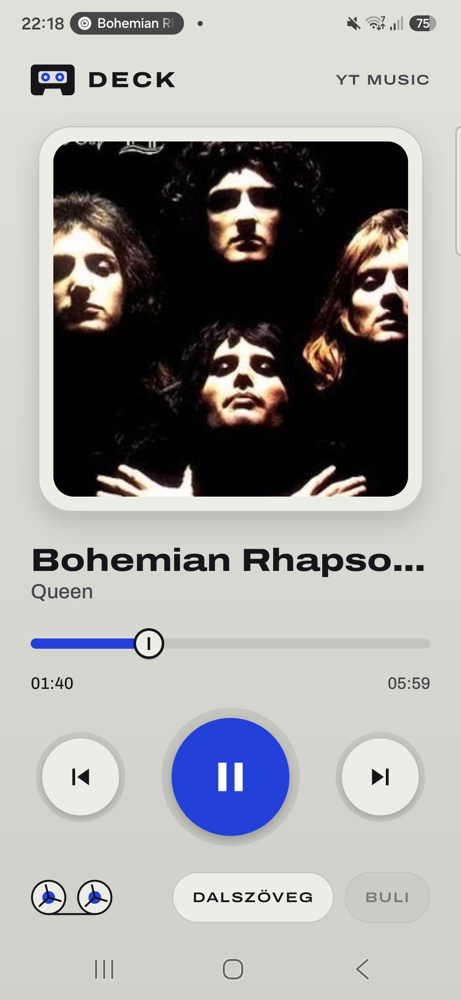

> Tisztított változat a Deck privát repójából (magyarul; az angol összefoglaló a fő README-ben van).
> Titkok, belső hivatkozások és projektazonosítók nélkül.

# Deck: dizájnirányok (redesign, 2026-11)

A Phase 2 "Glow + Analog Deck" dizájn visszajelzés alapján túl alap lett: unalmas fontok,
mindenhol téglalap, borostyán akcent. Ez a dokumentum a kutatást és a belőle kinőtt három
irányt rögzíti. Mindhárom be volt építve az appba, egy fejlesztői A / B / C váltóval lehetett cserélni őket a telefonon.

| A – Kazetta | B – Lemez | C – Pakli |
|---|---|---|
|  |  |  |

## 1. Kutatás: mit láttam, mi működik, mit veszünk át

| Forrás | Mit láttam | Mi működik benne | Mit veszünk át |
|---|---|---|---|
| **Material 3 Expressive** (Google, 2025) | Rugós (spring) mozgásrendszer; nagy, egymástól eltérő formák (cookie, sunny, pill, squircle); shape morphing az `androidx.graphics.shapes` könyvtárral (`RoundedPolygon`, `Morph`). | A forma maga is visszajelzés: a gomb állapotváltáskor átalakul, nem csak ikont cserél. A hierarchiát a méret- és formakülönbség hordozza. | Morfoló play gomb (**B**), csipkés "cookie" borítóforma (**B**), rugós animációk mindenhol. |
| **Nothing OS** | Dot-matrix tipográfia (NDot), monokróm felület, egyetlen akcent; az 5.0 már a Geist fontot is használja a dot font mellett. | Erős, felismerhető identitás nagyon kevés eszközből; a korlátozás maga a stílus. | A "monokróm + egy akcent" fegyelem (**A**, **C**). A dot-matrixot nem vesszük át: túl erősen a Nothing márkájához kötődik. |
| **Teenage Engineering** (OP-1, TP-7) | Hardveres, játékos, brutalista-de-meleg; világos ház, kevés, státuszt jelző élénk szín; minden vezérlő egy fizikai gomb vagy tárcsa. | Minden elem úgy néz ki, mint amit meg lehet nyomni; a korlátozott felület gyorsabb használatot ad. | **A** irány egésze: világos "készülékház", kerek billentyűk, fader-tekerő, forgó orsók. |
| **Apple Music / Spotify** now playing | Nagy borító mint fókusz; a dalszöveg teljes képernyős, nagy, félkövér sorokkal, az aktuális sor kiemelésével. A túl nagy borítót sokan kritizálják. | A dalszöveg nézet mint "karaoke" mód; a borítóból vett háttérszín. | A nagy, félkövér dalszövegsorok megmaradnak; a borító mérete a maradék helyhez igazodik (ez már most is így van). |
| **Metrolist** (YT Music kliens, M3) | Dinamikus színek a borítóból, "player button physics", bottom sheet animációk. | A gombok fizikailag reagálnak (rugó, lenyomódás). | Lenyomódás + rugó minden irányban. |
| **Namida** | A borítóhoz igazított player színek, **hullámforma tekerősáv**. | A tekerősáv maga is díszítőelem, nem csak egy vonal. | Hullámos tekerősáv (**B**). |
| **Gramophone** | Minimalista M3, Monet-színek, szavanként szinkronizált dalszöveg, dalszöveg widget. | Visszafogott, gyors, a dalszöveg kiemelt funkció. | Megerősíti, hogy a dalszöveg nézet a fő "plusz" egy ilyen appban. |

Közös tanulság: a jó lejátszók **egy** emlékezetes elemre költik a merészséget
(morfoló gomb, hullámzó tekerő, forgó orsó), a többi felület csendes.

Források:
[Android Authority – Material 3 Expressive](https://www.androidauthority.com/google-material-3-expressive-features-changes-availability-devices-3556392),
[Nothing – közösségi munkák / NDot](https://au.nothing.tech/blogs/news/celebrating-our-communitys-work),
[Digital Trends – Nothing OS 5.0](https://www.digitaltrends.com/phones/nothing-os-5-0-wants-you-to-stop-switching-apps-and-start-living-in-your-phone/),
[Teenage Engineering dizájnelemzés](https://blakecrosley.com/guides/design/teenage-engineering),
[OP-1 Field review](https://magazinmehatronika.com/en/op-1-field-review),
[Metrolist](https://sourceforge.net/projects/metrolist.mirror/),
[Namida](https://alternativeto.net/software/namida/about),
[Gramophone (F-Droid)](https://f-droid.org/en/packages/org.akanework.gramophone/),
[Spotify Now Playing view](https://newsroom.spotify.com/?p=23515).

Megjegyzés: a keresés kevés első kézből származó forrást adott (sok harmadik fél által
készített összefoglaló volt), ezért a fenti megfigyelések egy része másodkézből származik.

## 2. A három irány

Mindhárom ugyanazt a felületet adja (player, dalszöveg, engedély, üres állapot), a működés közös.
Ami irányonként más: paletta, fontok, formák, gombarányok, tekerősáv, VU, kis gombok, háttér, logó.

### A – "Kazetta" (hardveres, Teenage Engineering-szellem)

| | |
|---|---|
| Hangulat | Egy világos, matt műanyag zsebkészülék. Játékos, kézzelfogható, "meg lehet nyomni". |
| Paletta | Ház `#D8D9D3`, billentyű `#ECEDE7`, tinta `#15161A`, másodlagos `#45474D`, akcent **kobaltkék `#2340D8`** (fix). Kontraszt: tinta/ház 12,7:1, másodlagos 6,5:1, fehér/kék 7,5:1. |
| Fontok | **Archivo** (változtatható szélességű grotesk): címekhez széles (Expanded) és vastag vágás, szöveghez normál. |
| Formák | Kerek billentyűk: nagy kék kör play gomb (96dp), kisebb világos körök előző/következő (64dp); pill alakú címkegombok; a borító egy "kazettaablakban". |
| Tekerő | Fader: besüllyesztett vályú, kék kitöltés, kerek "gomb" fogó. |
| VU helyett | Két forgó **orsó** (kazettaorsó), csak lejátszás közben forog. |
| Háttér | Nincs elmosott színfolt: egyszínű készülékház. A mozgás az orsókban van. |
| Logó | Kazetta: ház, ablak, két kék orsó. |

### B – "Lemez" (Material 3 Expressive, sötét, borítóból színezve)

| | |
|---|---|
| Hangulat | Lemezjátszó egy sötét klubban. Puha, organikus, rugós. |
| Paletta | Háttér `#120F17`, felület `#1E1A25`, szöveg `#F2EEF7` (16,6:1), másodlagos 72% (8,9:1). Akcent **a borítóból** jön (Palette, világosra igazítva, hogy sötét háttéren olvasható maradjon), fallback levendula `#C7B2FF` (10,2:1). |
| Fontok | **Bricolage Grotesque** (karakteres, optikai méretezésű grotesk), címekhez ExtraBold. |
| Formák | A borító **csipkés "cookie" formába** vágva, lejátszás közben lassan forog, mint egy lemez. A play gomb **shape morph**: lejátszáskor csipkés "napocska", szünetben lekerekített négyzet, rugós átmenettel. Előző/következő: tonális pill. |
| Tekerő | **Hullámos** vonal a lejátszott részen (M3 Expressive), a hátralévő rész egyenes. |
| VU | 5 lekerekített pálca az akcentszínnel. |
| Háttér | A meglévő elmosott színfoltok a borító színeiből. |
| Logó | Hanglemez csipkés címkével. |

### C – "Pakli" (kártyapakli, buli mód felé)

| | |
|---|---|
| Hangulat | Kártyaasztal egy házibulin. Elegáns, kicsit játékos, a "deck of cards" jelentésre épít. |
| Paletta | Posztózöld `#0E3B2D`, kártyalap `#FBFAF6`, szöveg `#F6F7F2` (11,6:1), másodlagos 72% (6,8:1), akcent **kártyapiros `#D3283D`** (fix; fehér rajta 5,1:1, piros a kártyalapon 4,9:1). |
| Fontok | **Bodoni Moda** (kontrasztos didone, kártyalapok indexeihez illik) címekhez és a dalszöveghez, **Schibsted Grotesk** a kisebb szövegekhez. |
| Formák | A borító egy **kártyalapon** ül (sarokindex a cím kezdőbetűjével és egy ♦ jellel), számváltáskor a lap "megfordul". A play gomb egy **zseton**: piros kör, fehér sávokkal a peremén. Előző/következő: körvonalas körök. |
| Tekerő | Vékony fehér vonal, a fogó egy piros ♦. |
| VU | Zsetonoszlopok: kis ellipszisekből álló halmok. |
| Háttér | Posztó, finom középső fénnyel (vignetta). |
| Logó | Két legyezőszerűen elcsúsztatott kártya, elöl piros káró. |

## 3. Közös szabályok

- Érintési felület mindenhol legalább 48dp.
- A play gomb a fókusz (a legnagyobb elem), az előző/következő másodlagos.
- Minden nyomható elem lenyomódik (scale) és haptikus visszajelzést ad.
- Az irányok egy közös "skin" interfészen keresztül adták a színeket, fontokat, formákat
  és komponenseket, irányonként egy fájlban; a döntés után a két vesztes fájl, a fontjaik, logóik
  és launcher ikonjaik törölve lettek.
- Launcher ikon (adaptive + monochrome) mindhárom irányhoz készül, de egyszerre csak egy lehet
  aktív a manifestben (`android:icon`).

## Döntés: A – Kazetta, borító-gradienttel

A "Kazetta" irány nyert, világos marad. A B és C irány kódja törölve lett (a git történetben megvan),
a fenti leírás és a [design/](design/) mappa `A-*`, `B-*`, `C-*` képei a dizájnfolyamat dokumentációjaként maradnak.

Változás az eredeti A-hoz képest: az egyszínű házba **a borító színeiből készült, lágy pasztell
gradient** került (felül a fő szín, jobb felső sarokban egy második, bal alul egy halvány harmadik).
A színek 14–32%-os erővel keverednek a világos alapba, és ha egy szín túl sötét lenne, az erősség
addig csökken, amíg a másodlagos szöveg is meglesz 4.5:1 kontraszttal (unit teszt ellenőrzi a legrosszabb
eseteket). Szürke / fekete-fehér borítónál alig látható semleges árnyalat, borító nélkül halvány kobalt.

Végleges kép (v1.0): [design/final-player.png](design/final-player.png). A v1.1-ben (dizájn 2.0) jött a második,
REC-piros akcent (play gomb, buli, élő jelzések), a borító-mesh háttér és az animációk; a mai állapot a fő README képein látszik.

