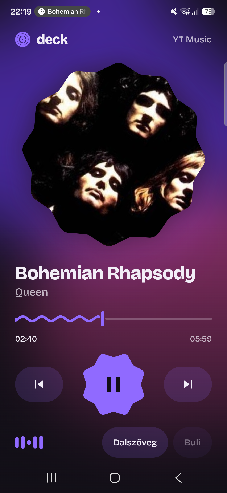
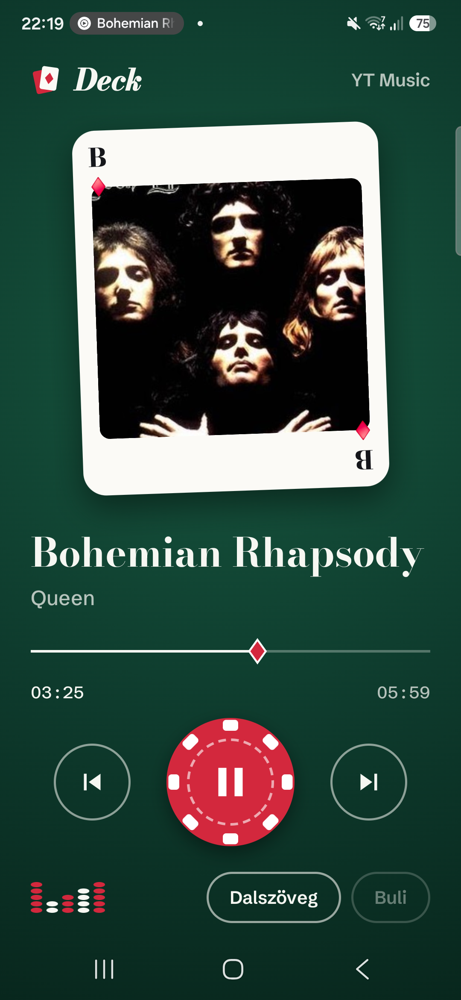

> Cleaned-up version from Deck's private repository. Magyar változat: [design-directions-hu.md](design-directions-hu.md).
> No secrets, internal references or project identifiers.

| A – Kazetta | B – Lemez | C – Pakli |
|---|---|---|
|  |  |  |

# Deck: design directions (redesign, 2026-11)

Feedback said the Phase 2 "Glow + Analog Deck" design was too plain: dull fonts, rectangles everywhere,
an amber accent. This document records the research and the three directions that grew out of it. All
three were built into the app, and a developer A / B / C switch swapped them on the phone.

## 1. Research: what I saw, what works, what we take

| Source | What I saw | What works | What we take |
|---|---|---|---|
| **Material 3 Expressive** (Google, 2025) | A spring motion system; big, contrasting shapes (cookie, sunny, pill, squircle); shape morphing with the `androidx.graphics.shapes` library (`RoundedPolygon`, `Morph`). | The shape itself is feedback: a button changes form when its state changes, not just its icon. Size and shape differences carry the hierarchy. | Morphing play button (**B**), scalloped "cookie" cover shape (**B**), spring animations everywhere. |
| **Nothing OS** | Dot-matrix type (NDot), monochrome surfaces, a single accent; 5.0 also uses the Geist font next to the dot font. | A strong, recognisable identity from very few means; the constraint is the style. | The "monochrome + one accent" discipline (**A**, **C**). Not the dot matrix: it is too tied to Nothing's brand. |
| **Teenage Engineering** (OP-1, TP-7) | Hardware-like, playful, brutalist but warm; a light housing, few vivid colors that signal state; every control is a physical button or knob. | Everything looks like it can be pressed; the limited surface makes use faster. | Direction **A** as a whole: a light "device housing", round keys, a fader seek bar, spinning reels. |
| **Apple Music / Spotify** now playing | A big cover as the focus; full-screen lyrics with large bold lines and the current line highlighted. Many criticise the oversized cover. | Lyrics as a "karaoke" mode; a background color taken from the cover. | The large, bold lyric lines stay; the cover size adapts to the remaining space (as it already does). |
| **Metrolist** (YT Music client, M3) | Dynamic colors from the cover, "player button physics", bottom sheet animations. | Buttons react physically (spring, press). | Press + spring in every direction. |
| **Namida** | Player colors matched to the cover, a **waveform seek bar**. | The seek bar is decoration too, not just a line. | Wavy seek bar (**B**). |
| **Gramophone** | Minimalist M3, Monet colors, word-synced lyrics, a lyrics widget. | Restrained, fast, lyrics as a key feature. | Confirms that the lyrics view is the main "extra" in an app like this. |

Common lesson: good players spend their boldness on **one** memorable element
(a morphing button, a wavy seek bar, a spinning reel); the rest of the surface is quiet.

Sources:
[Android Authority – Material 3 Expressive](https://www.androidauthority.com/google-material-3-expressive-features-changes-availability-devices-3556392),
[Nothing – community work / NDot](https://au.nothing.tech/blogs/news/celebrating-our-communitys-work),
[Digital Trends – Nothing OS 5.0](https://www.digitaltrends.com/phones/nothing-os-5-0-wants-you-to-stop-switching-apps-and-start-living-in-your-phone/),
[Teenage Engineering design analysis](https://blakecrosley.com/guides/design/teenage-engineering),
[OP-1 Field review](https://magazinmehatronika.com/en/op-1-field-review),
[Metrolist](https://sourceforge.net/projects/metrolist.mirror/),
[Namida](https://alternativeto.net/software/namida/about),
[Gramophone (F-Droid)](https://f-droid.org/en/packages/org.akanework.gramophone/),
[Spotify Now Playing view](https://newsroom.spotify.com/?p=23515).

Note: the search turned up few first-hand sources (many were third-party summaries), so some of the
observations above are second-hand.

## 2. The three directions

All three provide the same surfaces (player, lyrics, permission, empty state); the behaviour is shared.
What differs per direction: palette, fonts, shapes, button proportions, seek bar, VU, small buttons, background, logo.

### A – "Kazetta" (cassette: hardware, Teenage Engineering spirit)

| | |
|---|---|
| Mood | A light, matte plastic pocket device. Playful, tangible, "you can press it". |
| Palette | Housing `#D8D9D3`, key `#ECEDE7`, ink `#15161A`, secondary `#45474D`, accent **cobalt blue `#2340D8`** (fixed). Contrast: ink/housing 12.7:1, secondary 6.5:1, white/blue 7.5:1. |
| Fonts | **Archivo** (a variable-width grotesque): wide (Expanded) and bold cuts for titles, normal for text. |
| Shapes | Round keys: a big blue circular play button (96dp), smaller light circles for previous/next (64dp); pill-shaped label buttons; the cover sits in a "cassette window". |
| Seek bar | Fader: a recessed trough, blue fill, a round "knob" handle. |
| Instead of a VU | Two spinning **reels** (cassette reels), turning only during playback. |
| Background | No blurred color blobs: a single-color housing. The motion is in the reels. |
| Logo | A cassette: housing, window, two blue reels. |

### B – "Lemez" (record: Material 3 Expressive, dark, colored by the cover)

| | |
|---|---|
| Mood | A record player in a dark club. Soft, organic, springy. |
| Palette | Background `#120F17`, surface `#1E1A25`, text `#F2EEF7` (16.6:1), secondary 72% (8.9:1). The accent comes **from the cover** (Palette, lightened so it stays readable on dark), fallback lavender `#C7B2FF` (10.2:1). |
| Fonts | **Bricolage Grotesque** (a characterful grotesque with optical sizes), ExtraBold for titles. |
| Shapes | The cover is cut into a **scalloped "cookie" shape** and slowly turns during playback, like a record. The play button is a **shape morph**: a scalloped "sunny" while playing, a rounded square when paused, with a springy transition. Previous/next: tonal pills. |
| Seek bar | A **wavy** line on the played part (M3 Expressive), the rest straight. |
| VU | 5 rounded bars in the accent color. |
| Background | The existing blurred color blobs from the cover's colors. |
| Logo | A record with a scalloped label. |

### C – "Pakli" (deck of cards, towards party mode)

| | |
|---|---|
| Mood | A card table at a house party. Elegant, a bit playful, built on the "deck of cards" meaning. |
| Palette | Felt green `#0E3B2D`, card `#FBFAF6`, text `#F6F7F2` (11.6:1), secondary 72% (6.8:1), accent **card red `#D3283D`** (fixed; white on it 5.1:1, red on the card 4.9:1). |
| Fonts | **Bodoni Moda** (a high-contrast didone that suits card indices) for titles and lyrics, **Schibsted Grotesk** for smaller text. |
| Shapes | The cover sits on a **playing card** (a corner index with the title's first letter and a ♦), and the card "flips" when the track changes. The play button is a **chip**: a red circle with white stripes on its rim. Previous/next: outlined circles. |
| Seek bar | A thin white line, the handle is a red ♦. |
| VU | Chip stacks: piles of small ellipses. |
| Background | Felt, with a soft light in the middle (vignette). |
| Logo | Two fanned cards, a red diamond in front. |

## 3. Shared rules

- Touch targets at least 48dp everywhere.
- The play button is the focus (the biggest element); previous/next are secondary.
- Every pressable element presses in (scale) and gives haptic feedback.
- The directions provided colors, fonts, shapes and components through a shared "skin" interface, one file
  per direction; after the decision the two losing files, their fonts, logos and launcher icons were deleted.
- A launcher icon (adaptive + monochrome) was made for all three, but only one can be active in the
  manifest at a time (`android:icon`).

## Decision: A – Kazetta, with a cover gradient

The "Kazetta" direction won and stays light. The code of B and C was deleted (it is in the git history); the
description above and the `A-*`, `B-*`, `C-*` images in the [design/](design/) folder remain as documentation of the design process.

Change from the original A: the single-color housing got **a soft pastel gradient made from the cover's
colors** (the main color at the top, a second one in the top-right corner, a faint third one bottom left).
The colors are mixed into the light base at 14–32% strength, and if a color would be too dark, the strength
goes down until the secondary text still has 4.5:1 contrast (a unit test checks the worst cases). A grey /
black-and-white cover gives a barely visible neutral tint, no cover gives a faint cobalt.

Final image (v1.0): [design/final-player.png](design/final-player.png). Version 1.1 (design 2.0) added a second,
REC-red accent (play button, party, live marks), the cover mesh background and the animations; the current
look is in the main README's images.
